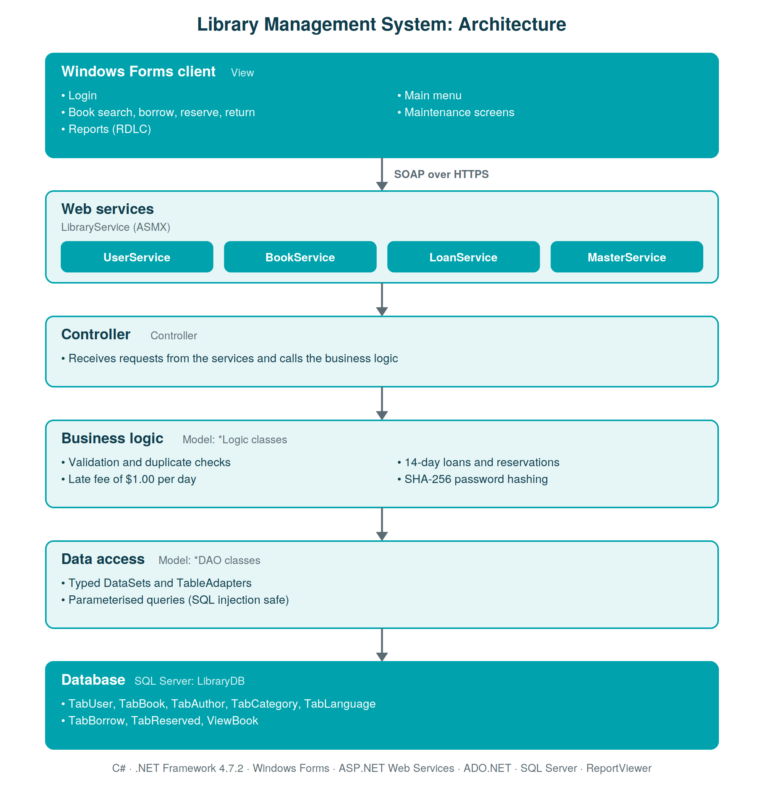

# Library Management System

A Windows desktop application for running a small library: searching the catalogue, borrowing, reserving and returning books, managing users and books, and printing reports. The desktop client talks to the database through a set of SOAP web services, following a layered architecture.

Built in C# / .NET Framework as an individual project for the Enterprise Systems unit of my Bachelor of Information Technology at the Academy of Interactive Technology (AIT), Sydney.

## Features

**Students**
- Search books by title, author or category
- Borrow a book (14-day loan), reserve a book that is on loan, and return books
- Late returns are charged automatically at $1.00 per day

**Staff and administrators**
- Maintain books, authors, categories and languages (add, update, delete)
- Maintain user accounts with three access levels: Student, Staff, Administrator
- Three reports built with ReportViewer (RDLC): books currently borrowed, overdue books and reservations

## Architecture

- **View**: Windows Forms screens. It only calls the web services and never touches the database directly.
- **LibraryService**: ASMX web services. Only basic types and DataTables cross the network.
- **Controller / Model**: business rules (validation, loan period, late fees, duplicate checks) and data access through typed DataSets and TableAdapters.

## Tech stack

C#, .NET Framework 4.7.2, Windows Forms, ASP.NET Web Services (ASMX), ADO.NET typed DataSets, SQL Server, ReportViewer (RDLC).

## Security

- Passwords are hashed with SHA-256 before they are stored, and the hash never leaves the server.
- All database access uses parameterised queries, which protects against SQL injection.
- Screens and actions are restricted by user level.

## Getting started

**Requirements:** Visual Studio 2022 (17.13 or later, for the `.slnx` solution) with the .NET desktop and ASP.NET workloads, and SQL Server LocalDB (installed with Visual Studio).

1. Open `Database/LibraryDB.sql` in SQL Server Management Studio or Visual Studio and run it. It creates the `LibraryDB` database with sample data.
2. Open `LibraryManagementSystem.slnx` in Visual Studio. NuGet packages are restored automatically on the first build.
3. If you use a SQL Server instance other than LocalDB, update the connection string in `LibraryService/Web.config`.
4. Set **LibraryService** and **View** as multiple startup projects (LibraryService first) and press **Ctrl+F5**. The services run on `https://localhost:44396/`.

## Test accounts

All sample data is fictitious.

| Username | Password | Level |
| --- | --- | --- |
| admin | Admin@2026 | Administrator |
| staff | Staff@2026 | Staff |
| tester | Tester@2026 | Student |

## What I learned

- Separating the application into layers, so the client can change without touching the business rules or the database
- Exposing business logic through web services and keeping objects on the server side
- Enforcing business rules (loan period, late fees, reservations) in one place instead of in each screen
- Building reports from live data with RDLC

## Author

**Luiza Miranda Gomes**, Sydney, Australia
[LinkedIn](https://www.linkedin.com/in/luiza-miranda-gomes-079190311) | [GitHub](https://github.com/Lmg15186)
